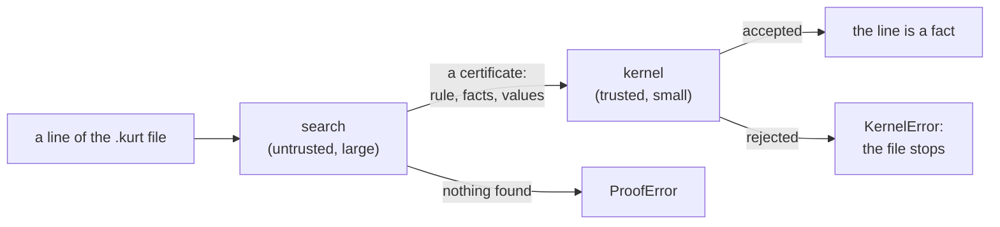
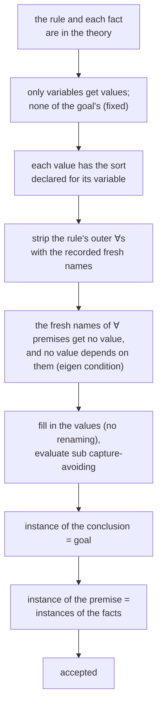
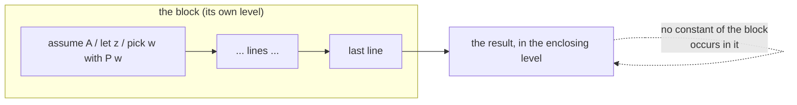
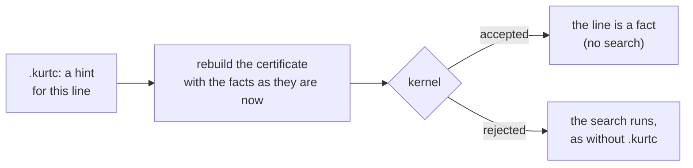

# Kurt's kernel, step by step

This document explains how Kurt checks a proof a second time, with the kernel: what a step's
certificate is, what the kernel does with it, and why that makes the result trustworthy. It is the
long form of `doc/kurt-soundness.md` §9, with examples. Every output below is what Kurt printed
for the example (Kurt 0.8.3/0.9), not made up.

## 1. Two parts: the search and the kernel

Kurt has to find a proof of each line: which rule, which facts, which values for the variables.
That is the *search* (`derive_expr`, `impl_elim`, unification, `sub` matching, stripping
quantifiers, ...). It is large, clever and fast -- and almost every soundness bug ever found in
Kurt was there (`doc/kurt-soundness.md` §0-§8).

So the search doesn't decide. For each step it accepts, it hands over a **certificate**: the rule,
the facts, the values. The **kernel** (`kernel_verify`) checks the certificate on its own, without
any search: it fills in the values, compares, and says yes or no.



This is the idea of LCF (Milner's theorem prover, and HOL, Isabelle and others after it): only a
small, fixed piece of code can make a fact, and everything else must go through it. A bug in the
search can then make Kurt fail to find a proof, or find a slow one, but not accept a wrong one --
unless the kernel has the same bug. De Bruijn's criterion asks the same of a proof checker: the
proof must be checkable by a program small enough to be checked by hand. Kurt's kernel is about
600 lines (`kernel_verify`, `kernel_verify_block` and the `k_*` functions), the search many
thousands.

The kernel checks *every* step, always -- not only in a test or with an option. A step it rejects
doesn't count: `KernelError` stops the file (in the shell, only that line fails), and no `expect`
can catch it. A rejection means that the search and the kernel disagree, a bug in one of them, to
be reported.

## 2. What a certificate contains

A `Certificate` (kurt.py) has:

| field | what it is |
|---|---|
| `kind` | `rule` (most steps), or `top`, `calc`, `calc-fact`, `todo`, `case-elim`, or a block rule (`impl-intro`, `not-intro`, `forall-intro`, `exists-elim`) |
| `goal` | the line to prove |
| `fixed` | the free variables of the goal: they stand for anything, so they get no value |
| `rule` | the fact or rule used -- a formula of the theory |
| `form` | how the rule is read: `fact` (the goal is an instance of it) or `impl` (premise ⇒ conclusion) |
| `expr` | the rule as read: the formula, or one direction `L ⇒ R` of an `iff` |
| `values` | a value for each variable of the rule (`$x := c`, `%A := P $x`) |
| `facts` | the facts that match the parts of the premise |
| `premise_fresh`, `conclusion_fresh`, `fact_fresh` | the fresh names the search used for the outer `∀`s it stripped |
| `block` | for closing a block: the block's level |

`cert N` shows the certificates of line N, and `kurt FILE.kurtc` all of them (§6). The simplest
example, modus ponens:

```
bool A, B
use A implies B
use A
B
```

```
   4  B                                         ; by 2(3)
```

```
line 4: B
  goal:      `B`
  rule:      `A implies B` (line 2)
  read as:   premise ⇒ conclusion
  premise:   `A` (line 3)
  kernel:    checked
```

The reason Kurt prints, `by 2(3)`, is the certificate in short: the rule of line 2, applied to the
fact of line 3.

## 3. What the kernel checks for a rule

For a certificate of kind `rule`, `kernel_verify` does this, in order:



1. **The rule and the facts are known.** Each is a formula in the theory at this point
   (`k_known`) -- not a copy that looks like one. An `iff` may be used in one direction.
2. **Values only for variables, not for the goal's.** A constant never gets a value. A free
   variable of the goal stands for anything, so it must stay as it is.
3. **Sorts.** A value satisfies the sorts declared for its schema variable (`k_has_sort`).
4. **Stripping `∀`s.** A rule `∀ x (P x ⇒ Q x)` is used without its `∀`; the search renamed `x`
   to a fresh name, and the certificate says which. The kernel strips with exactly those names.
5. **The eigen condition.** A premise `∀ y P y` must hold for *every* `y`: its name is fresh (one
   that only the search makes, `$$07`, named once, not fixed by a block, in neither the goal nor a
   cited fact -- not a constant `c`, which would make "for all" out of "for `c`"), it gets no
   value, and no non-boolean variable of the rule may depend on it. This is the condition whose
   absence was the worst bug ever found (`doc/kurt-soundness.md` §0).
6. **Filling in.** The values are put in *without renaming* (`k_instantiate`): a value may contain
   a variable bound at its place only where that is meant -- a boolean `%A` may, a term `$T` only
   its own bound variable (`k_dependencies`). Then each `sub $x $a T` is evaluated by the kernel's
   own capture-avoiding substitution (`k_replace`).
7. **The conclusion is the goal**, up to renaming bound variables (`k_equal`).
8. **The premise is covered by the facts**: each part of it is an instance of a fact, or a
   conjunction of such parts, or a `∀` whose body is one (with a recorded fresh name).

### 3.1 A fact: the goal is an instance

```
load equality
const a, b
use a = b
b = a
```

```
line 4: b = a
  goal:      `b = a`
  rule:      `a = b` (line 3)
  read as:   a fact, the goal is an instance of it
  kernel:    checked
```

No premise, no facts. `b = a` is `a = b` because `=` is symmetric: both are the same term in the
normal form (§7).

### 3.2 A rule of a theory, with values

```
load prop
bool A, B
use A and B
A
```

```
line 4: A
  goal:      `A`
  rule:      `(%A and %B) implies %A` (prop.kurt:76 "and-elim")
  read as:   premise ⇒ conclusion
  values:    %A := `A`
             %B := `B`
  premise:   `A and B` (line 3)
  kernel:    checked
```

The kernel fills in `%A := A`, `%B := B`: the conclusion is `A`, the goal; the premise is
`A and B`, the fact of line 3.

### 3.3 A rule with `∀`

```
load logic
var x
use ∀ x (P(x) implies Q(x)) "pq"
use P(c)
Q(c)
```

```
line 5: Q(c)
  goal:      `Q c`
  rule:      `(P x) implies (Q x)` (line 3 "pq")
  read as:   premise ⇒ conclusion
  values:    x := `c`
  premise:   `P c` (line 4)
  kernel:    checked
```

### 3.4 A premise with `∀`: the eigen condition

```
load logic
use ∀ y P(y)
use (∀ y P(y)) implies C
C
```

```
; line 4:
; goal:      `C`
; rule:      `(∀ y1 (P y1)) implies C` (line 3)
; read as:   premise ⇒ conclusion
;            the `∀` of the premise with the fresh y2, which get no value
; values:    y3 := `y2`
; premise:   `P y3` (line 2)
; kernel:    checked
```

The premise `∀ y1 (P y1)` is stripped with the fresh `y2`, and `P y2` must be an instance of the
fact `P y3` of line 2 -- which holds for any `y3`. `y2` itself gets no value: had the search given
it one (say `c`), the kernel would reject the step, since `P c` doesn't give `∀ y P y`.

### 3.5 `sub`: substitution, without capture

```
load logic
const c
use P(c)
∃ y P(y)
```

```
; line 4:
; goal:      `∃ y (P y)`
; rule:      `(sub $x $a %A) implies (exists $x %A)` (logic.kurt:31 "exists-intro")
; read as:   premise ⇒ conclusion
; values:    $a := `c`
;            %A := `P $x`
; premise:   `P c` (line 3)
; kernel:    checked
```

The conclusion `exists $x (P $x)` is the goal up to the name of the bound variable. The premise
`sub $x c (P $x)` is evaluated by the kernel to `P c`, the fact of line 3. The boolean `%A` may
contain the bound `$x`; a term variable `$T` couldn't (§3, step 6).

## 4. The other kinds of steps

### 4.1 `true` and `calc`

```
load prop, numbers
true
calc on
2 + 3 = 5
use x = 2 + 3
x = 5
```

```
line 2: true
  goal:      `true`
  by:        "top-intro"
  kernel:    checked

line 4: 2 + 3 = 5
  goal:      `5 = 5`
  by:        calc, computing the comparison
  kernel:    checked

line 6: x = 5
  goal:      `x = 5`
  by:        calc, from `x = (2 + 3)` (line 5), which computes to the goal
  kernel:    checked
```

`top` is accepted only for the goal `true`. `calc` only if the comparison of numbers holds after
computing (`numeric_comparison_holds`); `calc-fact` only if a known fact computes to the same term
as the goal.

### 4.2 `case`: n alternatives

```
load prop
bool A, B, C
use A or B
use A implies C
use B implies C
show C
proof
    case A
        C
    case B
        C
qed
```

```
line 12: qed
  ...
  goal:      `C`
  by:        n-ary case elimination
  rule:      `((%%31 implies %%32) and (%%33 implies %%32) and (%%31 or %%33)) implies %%32` (prop.kurt:82 "or-elim")
  split:     `A or B` (line 3)
  cases:     `A implies C` (line 8-9)
             `B implies C` (line 10-11)
  kernel:    checked
```

The kernel checks that the rule is the general binary `or-elim` of the theory, that the first fact
is a disjunction, and that there is exactly one implication per alternative, in order, each from
its alternative to the goal. The search only chooses this list; it never asks the unifier to
combine n premises at once.

### 4.3 `todo`

`todo A or B` is admitted without proof; its certificate says so, and the file is then "almost
checked" (`Proof almost checked: 1 todo.`), never "checked".

## 5. Closing a block

A block (`assume`, `case`, `let`, `pick`) gives a new fact when it closes. Its certificate names
the block and its last line, and `kernel_verify_block` checks it against the block's own level:



| block | rule | the result must be |
|---|---|---|
| `assume A` (or `case A`) | impl-intro | `A ⇒ last line` |
| `assume A`, last line `false` | not-intro | `¬A` |
| `let z` | forall-intro | `∀ z (last line)`, with `z` new in the block |
| `pick w with P w` | exists-elim | the last line; `P w` is the body of a known `∃ y P y` with `w` for `y`, and `w` new in the block |

And for each: no individual constant of the block occurs in the result (`no_escape`) -- the
witness of a `pick` never.

```
load prop, logic
bool A, B, C
use A implies B
use B implies C
assume A
    B
    C
```

```
   5  assume A                                  ; open block with assumption
   6      B                                     ; by 3(5)
   7      C                                     ; by 4(6)
      A implies C                               ; 5-7 by impl-intro
```

```
  goal:      `A implies C`
  by:        "impl-intro", closing the block `assume A`
  last line: `C` (line 7)
  kernel:    checked
```

`let` and `pick`, in the same file (lines 8-15):

```
use ∀ y P(y)
use ∀ y (P(y) implies Q(y))
let z
    Q(z)
use ∃ y P(y)
use ∀ y (P(y) implies C)
pick w with P(w)
    C
```

```
  goal:      `forall z (Q z)`
  by:        "forall-intro", closing the block `let z`
  last line: `Q z` (line 11)
  kernel:    checked

  goal:      `C`
  by:        "exists-elim", closing the block `pick w`
  picked:    `P w` from `∃ y (P y)` (line 12)
  last line: `C` (line 15)
  kernel:    checked
```

(The certificate of closing a block is listed under the line at which the block closed, the next
line of the file.)

## 6. Certificates on disk: `.kurtc`

After a file is checked, Kurt writes its certificates next to it, `FILE.kurtc` (a JSON file: the
SHA-256 of the source, Kurt's version, and per line the rule, the facts by file, line and term,
the fresh names and the values). The next run uses them to skip the search:



A stored certificate is only a **hint**. It is rebuilt against the theory as it is now -- the
rule and the facts must be there, at their lines, with their terms -- and it must pass the kernel,
like a certificate from the search. If anything is off (the file changed, a theory changed, the
`.kurtc` was edited), the hint doesn't work and the search runs; the result is the same as
without `.kurtc`.

A forged certificate: the file

```
bool A, B
use A
use B implies A
B
```

with a `.kurtc` of the right hash that claims `B` by the rule `B implies A` from the fact `A`. The
kernel rejects it (the conclusion of the rule is `A`, not `B`), the search runs, and finds
nothing:

```
ProofError: can not derive `B`
```

(`tests/test_kurtc.py` checks this.) This is the design rule of Kurt: **the `.kurt` file is the
only source of truth.** Anything Kurt writes is either Kurt source that is checked again, or hints
that the kernel checks again -- never a second copy of facts that is believed on its own.

`kurt FILE.kurtc` shows the stored certificates, readable; `kurt --no-kurtc` neither reads nor
writes them.

## 7. What is trusted, and what isn't

The kernel can only be as right as what it relies on. Besides its own code, that is:

- **The parser**, which turns the text into terms. A wrong parse gives a wrong statement that is
  then proved correctly -- the kernel can't see that.
- **The normal forms** (`normalize_expr`): `flat` (regrouping), `sym` (the order of the
  arguments), and `calc` (literal arithmetic). They define when two terms are the same, like the
  definitional equality of a type theory. They are small and separate from the search.
- **The theories' axioms.** `use` adds a fact without proof. The kernel checks that a step follows
  from the facts -- not that the facts are true. A wrong `use` (`use 1 = 2`) makes everything
  provable. The theories that come with Kurt are reviewed; under `--strict` (for grading) a
  file may not contain `use`, `todo` or `chain` outside the trusted theories.
- **`def`**: a definition is a new fact too. Kurt accepts only forms that are conservative -- the
  left side is the new symbol applied to distinct variables, the right side has no other
  variables, and not inside a proof block -- so that a definition adds no new truths about the old
  symbols (`doc/kurt-soundness.md` §8.17).
- **Plain helpers** (`is_forall`, `get_token_set`, ...), and `expr_str`, only for messages.

Not trusted: everything of the search -- its unification, its alpha-equivalence, its substitution,
its reading of a binder's condition. The kernel has its own (`k_equal`, `k_replace`, `k_bound`).
`tests/test_kernel_boundary.py` checks which functions of the module the kernel calls: none of the
search. `tests/test_kernel_differential.py` compares the kernel's and the search's equality and
substitution on generated terms. The kernel sees the knowledge base only through `KernelEnv`, a
read-only view, so it can't change anything while it checks.

```
            trusted                         not trusted
   ┌──────────────────────────┐    ┌──────────────────────────────┐
   │ kernel (k_*, kernel_     │    │ search: derive_expr,         │
   │   verify, ..._block)     │    │   impl_elim, unification,    │
   │ parser                   │    │   sub matching, ∀ stripping  │
   │ normal forms (flat, sym, │    │ .kurtc files (hints)         │
   │   calc)                  │    │ the editors, the LSP         │
   │ the theories' axioms     │    │ --latex, --markdown, --lean  │
   │ def (conservative forms) │    │                              │
   └──────────────────────────┘    └──────────────────────────────┘
```

## 8. How the kernel itself is tested

- Every step of every proof file, theory, lesson and exercise in the test suite goes through the
  kernel -- a rejection anywhere fails the tests.
- `tests/test_kernel.py` takes real certificates and breaks them: no facts, another goal, a rule
  not in the theory, a value for a goal variable, a value depending on a fresh variable, a capture;
  for blocks another result, no `∀`, not the last line, a witness that escapes. The kernel must
  reject each one.
- `proofs/soundness/` holds proof attempts that must fail -- most of them old bugs of the search,
  which the kernel would now catch even if they came back.
- `kurt --lean` (a prototype) translates the certificates to Lean 4, so that Lean's kernel can
  check a proof a third time.

So far the kernel and the search disagreed twice, and both times the kernel was wrong (too
strict: `=` and `iff` in either order, and a fact covering several flat conjuncts) -- the search
had found real proofs.
